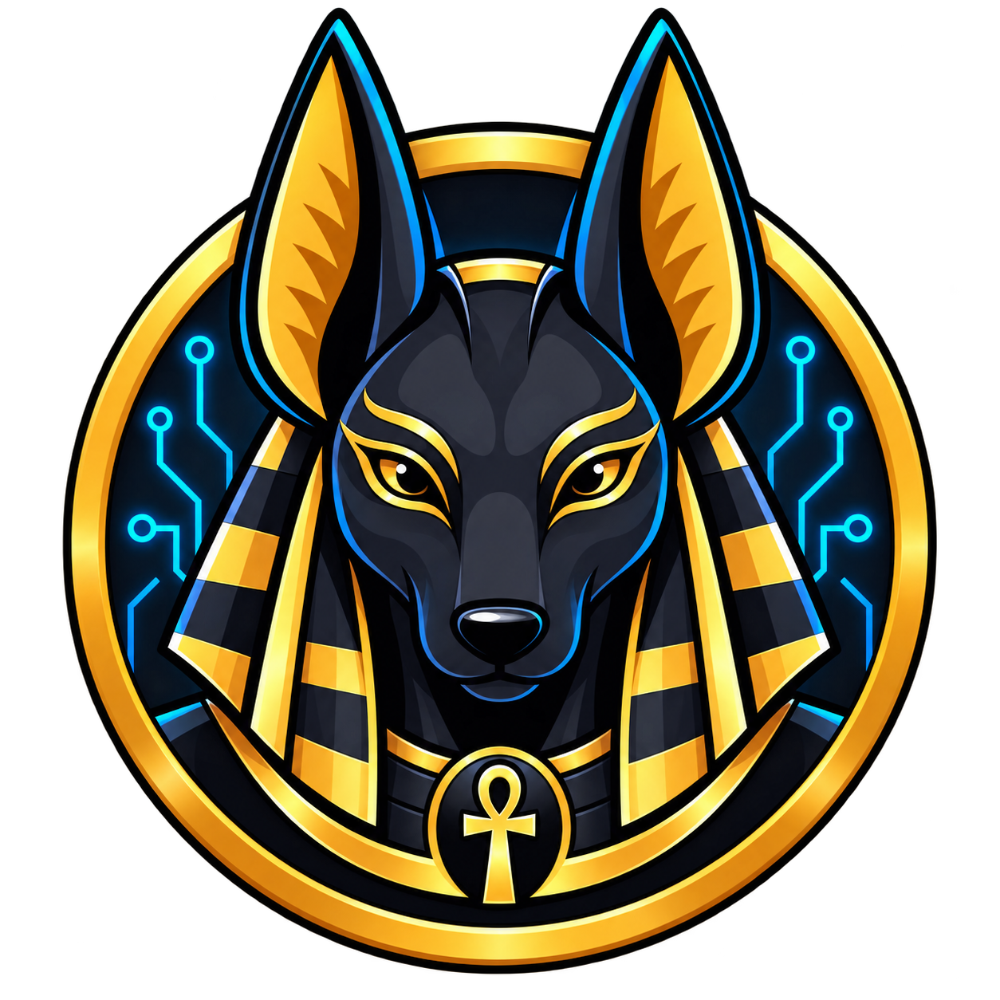

<p align="center">
  
</p>

# TYPO3 Paint

**Paint the TYPO3 backend in your own colors, without writing CSS.**

TYPO3 Paint lets administrators set the colors of the TYPO3 v14 backend: primary color, secondary color, icon accent, top bar, module menu and tinting. Use it to match a corporate design or to tell installations apart (development, staging, production) at a glance.

The settings apply to the whole installation and to all backend users, whatever theme (*Fresh*, *Modern*, *Classic*) each user selected.

---

## Features

- **Primary color**: buttons, links, focus and active states. In the *Fresh* theme the top bar and module menu are derived from it.
- **Secondary color** and **icon accent color**
- **Top bar** and **module menu**: background and text color
- **Tinting**: how strongly grey surfaces and state colors pick up the primary color
- Every setting is optional. Empty keeps the theme default.
- Works in the backend frame, all module iframes, the login page and the link/element browsers
- No effect on the frontend

## Requirements

- TYPO3 14.3 or higher (14.x)

## Installation

```bash
composer require anubit/typo3-paint
vendor/bin/typo3 extension:setup -e typo3_paint
vendor/bin/typo3 cache:flush
```

## Configuration

Go to **Admin Tools > Settings > Extension Configuration > typo3_paint**. Settings are grouped in the tabs **Colors**, **Header & Sidebar** and **Tinting**.

| Setting | Type | Effect |
|---|---|---|
| `primaryColor` | color | Main accent color |
| `secondaryColor` | color | Secondary buttons and badges |
| `iconAccentColor` | color | Accent part of the core icons |
| `headerBackgroundColor` | color | Top bar background |
| `headerTextColor` | color | Top bar text and icons |
| `sidebarBackgroundColor` | color | Module menu background |
| `sidebarTextColor` | color | Module menu text |
| `neutralMix` | 0-100 | Tint of grey surfaces in percent |
| `stateHarmonize` | 0-100 | Tint of state colors in percent |

Colors must be hexadecimal (for example `#205eb5`). Invalid values are ignored.

> **Reload the whole backend after saving** (for example F5). The frame around the modules is not reloaded automatically.

> **Tip:** only hue and saturation of the primary color are used, the theme sets the lightness. For an exact top bar or module menu color, use `headerBackgroundColor` and `sidebarBackgroundColor`.

Settings can also be set in `config/system/additional.php`:

```php
$GLOBALS['TYPO3_CONF_VARS']['EXTENSIONS']['typo3_paint']['primaryColor'] = '#205eb5';
```

## How it works

An event listener for `TYPO3\CMS\Core\Page\Event\BeforeStylesheetsRenderingEvent` adds one inline `<style>` block with CSS custom properties (for example `--token-color-primary-base`) to every backend document. The TYPO3 backend CSS derives all shades and theme colors from them. Only hex colors and whole numbers are accepted, the block gets a CSP nonce, and the listener only runs for backend requests.

## Known limitations

- The TYPO3 backend CSS is internal API and can change with any TYPO3 release. Check the backend after updates.
- The colored workspace bar is not controlled by this extension.

## Documentation

Full documentation: see the [`Documentation/`](Documentation/Index.rst) folder.

## License

GPL-2.0-or-later. Author: Anu Bhuvanendran Nair.
